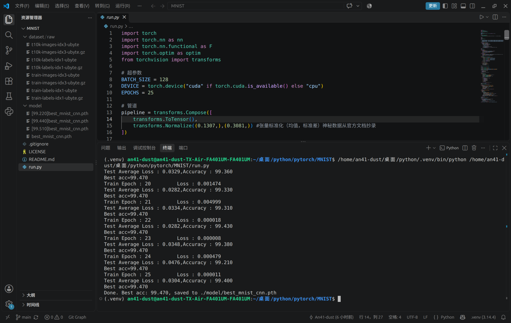

# MNIST项目练习

本项目是中北大学A413实验室人工智能方向第一周的任务产出，在**不使用**`torchvision.datasets`的前提下完成了对数据集的解析与加载，最终实现了稳定99.4%，**最高99.51%** 的准确率。

## 文件结构
```
MNIST/
├── datasets/
│ └── raw/               # MNIST 原始数据集（自动下载）           
├── model/
│ └── best_mnist_cnn.pth # 训练过程中表现最佳的模型
├── run.py               # 主程序文件（下载+训练+测试）
└── README.md
```
> `dataset/` 与 `model/` 目录均会在首次运行时自动创建。

## 运行环境

- 系统 Ubuntu 26.04（任意系统均可）
-  Python 3.14.4（≥ 3.9）
-  PyTorch 2.14.1（≥ 1.10）
-  Numpy
-  torchvision（仅transforms）
-  CUDA 13.2（可选）

#### 安装依赖
```
pip install torch torchvision numpy
```
## 模型结构

- 输入层：28×28灰度图像
- 卷积层1：32个5×5卷积核（padding=2）
- 激活层1：ReLU
- 池化层1：2×2最大池化，步长2
- 卷积层2：64个3×3卷积核（padding=1）
- 激活层2：ReLU
- 池化层2：2×2最大池化，步长2
- 卷积层3：64 个3×3卷积核（padding=1）
- 激活层3：ReLU
- 展平层：64×7×7 = 3136 维
- 全连接层1：256个神经元
- 激活层4：ReLU
- Dropout 层：丢弃概率0.5
- 输出层：10个神经元（对应0-9十个数字），经 log_softmax 输出对数概率

## 首次运行

运行会自动完成以下步骤：
1.  从 [PyTorch 官方镜像源](https://ossci-datasets.s3.amazonaws.com/mnist/) 下载 4 个 .gz 文件；
2. 解压得到IDX格式原始数据；
3. 解析图像与标签；
4. 自定义DataLoader，开始训练
5. 每轮测试后，将最高准确率模型保存至`./model/best_mnist_cnn.pth`

运行完毕后输出如图：


## 预期结果

在 25 个 Epoch 内，测试集准确率通常可达 **99% 以上**，且收敛速度较快。

## 一些杂谈

刚接到这个任务时，坦白讲，我连 `MNIST` 是什么都不知道。在网上找视频资源，找到的大多侧重于神经网络模型的讲解；而知乎、CSDN 上的帖子虽然偏向代码，但对我这样的初学者并不友好——`torch`、`torch.nn` 等模块里的函数我都不清楚用法，看也看不懂，学也无从学起。项目开始的第一天，我只能先着手配置 `git` 之类的简单工作（就这样简单的工作我都搞了两天才搞好）。

后来我调整了搜索关键词，从 `MNIST` 换成 `PyTorch`，总算找到了讲解比较详细的视频（至少会讲清整个代码流程、函数的作用以及传入参数的含义），在视频的帮助下~~抄~~写完了主体代码。

对于"不使用 `torchvision.datasets`"这一要求，我决定求助于ds大人。
大致流程是：先询问`datasets`原本发挥的作用 **→** 写大纲，分模块代替原有功能 **→** 让它写一份实现功能的代码 **→** 再让它逐步解释每段代码的含义

#### prompt
```
好的，现在你给我逐步翻译"解析 idx 格式"中每一句代码的作用，包括这句代码调用的函数的作用和使用方法（参数传入相关也要解释）
```

最后耗费了大量时间，也仅仅做到了"看懂代码"，离真正自己手写一份`MNIST`还有很大差距,对于神经网络的结构更是只参透了一点皮毛。但我也认为，一周之内从零开始学会写一份 `MNIST`难度确实较大，能达到这个效果，我比较满意了。

~~我本可以直接复制 AI 生成的代码，却偏偏选择了逐字摘抄别人写好的代码……最后也没有学会……我到底在干什么……~~

代码能跑之后，我在ds的帮助下做出了一些优化，更改模型参数，让最高的准确率达到了99.51%，我认为这是很不错的。

在训练代码跑通之后，我还加入了保存训练模型的代码，实际运用后发现它保存的是最后一次Epoch的模型，而不是效果最好的一次Epoch的模型，稍作修改后实现了保存准确率最高的模型。这也是刚开始学习时容易忽略的问题

## 参考
-   [PyTorch 官方镜像源](https://ossci-datasets.s3.amazonaws.com/mnist/)
-   [PyTorch 官方 MNIST 示例](https://github.com/pytorch/examples/tree/main/mnist)
-   [bilibili - 轻松学 PyTorch 手写字体识别 MNIST](https://www.bilibili.com/video/BV12i4y1G7ko)
-   [deepseek](https://chat.deepseek.com)

## License

MIT License © 2026 [An41-dust](https://github.com/An41-dust)


